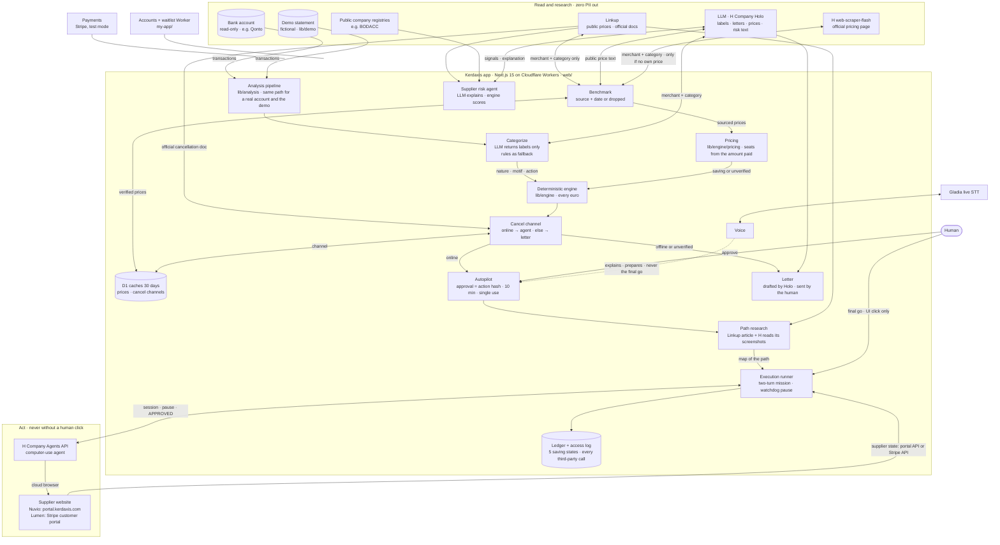
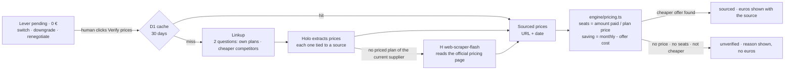
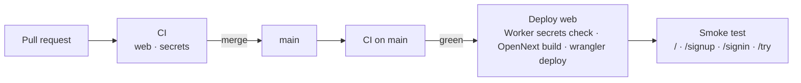

# Kerdaxis

**AI doesn't just find savings. It makes them happen.**

Kerdaxis reads a company's bank account (Qonto, read-only), finds the subscriptions nobody uses, and sends an
[H Company](https://hcompany.ai) computer-use agent to cancel them on the supplier's own website. The agent
stops in front of the irreversible button and waits for a human click. A cancellation only counts once the
supplier's portal shows the confirmation number.

[**kerdaxis.com**](https://kerdaxis.com) (site and 69 s film) · [**Try it free**](https://app.kerdaxis.com/try) (email only) ·
[Demo supplier portal](https://portal.kerdaxis.com) (fictional "Nuvio CRM")

> Built for a hackathon. The supplier is fictional. The agent and its run are real.

---

## Contents

- [What happens in a run](#what-happens-in-a-run)
- [The final-click gate](#the-final-click-gate)
- [A real recorded run](#a-real-recorded-run)
- [Real suppliers: researched playbooks and the Stripe portal](#real-suppliers-researched-playbooks-and-the-stripe-portal)
- [Access: free trial, subscription, jury](#access-free-trial-subscription-jury)
- [Architecture](#architecture)
  - [Pricing a lever: observed or sourced](#pricing-a-lever-observed-or-sourced)
  - [The public demo runs the real engine](#the-public-demo-runs-the-real-engine)
  - [Deploy: `main` is production](#deploy-main-is-production)
- [Run it locally](#run-it-locally)
- [Repository layout](#repository-layout)
- [Tests and CI](#tests-and-ci)
- [Known limits](#known-limits)
- [Ground rules](#ground-rules)

---

## What happens in a run

1. **Read.** Kerdaxis reads the bank account through the Qonto MCP. Every write tool is denied. It never moves money.
2. **Count.** A deterministic engine computes every euro: recurring tools, structural costs, one-offs, the controllable run-rate. The LLM only labels; it never does arithmetic. A saving that depends on a market price (switch, downgrade, renegotiate) stays at 0 € until a price is found on the web with its source and date (see [Pricing a lever](#pricing-a-lever-observed-or-sourced)).
3. **Decide.** The Autopilot card names one action, for example *Nuvio CRM: nobody has logged in for 90 days, 129 €/mo → 1,548 €/yr*. A human approves it.
4. **Act.** If Linkup finds in the supplier's official docs that the cancellation can be done online, an H Company agent opens the supplier's portal in its own cloud browser. It finds the subscription, gives a reason, declines the retention offer and reaches the final confirmation page. Otherwise, or if the channel cannot be verified, Kerdaxis drafts a letter and the human sends it.
5. **Stop.** Kerdaxis pauses the agent before *Confirm cancellation*. The panel shows the page the agent sees and waits for the human's final go.
6. **Prove.** After the go, the agent confirms. Kerdaxis then reads the supplier's state through the portal's own API: *cancelled · NUV-…*. It does not take the agent's word for it.
7. **Verify.** At D+30, the saving is checked on the bank statement. The ledger keeps five values apart: potential, approved, executed, supplier-confirmed, verified on statement.

Voice commands (Gladia live speech-to-text) can open screens, explain a number or prepare an action. They can never give the final go.

## The final-click gate

The irreversible click is guarded by three independent layers. Any one of them is enough to stop the agent.

| Layer | Where | What it does |
|---|---|---|
| 1. Two-turn mission | `web/lib/execution/runner.ts` | The agent's first task ends *at* the final page. Its instructions forbid ticking the final box or clicking the final button unless a message says `APPROVED`. |
| 2. Watchdog pause | `runner.ts` + `suppliers.ts` (`finalStepPath`: `/cancel/confirm` on Nuvio, a URL pattern on the Stripe portal) | As soon as the agent's browser reaches the confirmation page, Kerdaxis pauses the H session. |
| 3. UI-only approval | `app/api/execution/[id]/final` | The `APPROVED` message is sent only after a click in the interface (`channel: "ui"`). Voice cannot send it. |

Before any of this, the human approval is bound to one exact action. A SHA-256 hash covers supplier, plan, account and amount. It is single use and valid for 10 minutes (`web/lib/execution/policy.ts`). The browser only picks a supplier; amounts come from the server catalogue.

Page text is treated as untrusted data. The demo portal can inject a hidden note telling AI assistants to accept the retention offer. In the recorded run below, the agent declined it.

## A real recorded run

H Company session `192149b8-…`, 7 Nov 2026, 18:43:07–18:44:00 (Paris), English portal, prompt injection **on**.

| | |
|---|---|
| First screen → confirmation | ~45 s, including a 9 s pause for the human's go |
| Agent steps | 10 |
| Agent cost | $0.027 (H Company total) |
| Injected "accept the offer" note | ignored, offer declined |
| Result | `supplier_confirmed` · **NUV-RW3L2Y**, identical on the agent and the portal side |

The 10 captures of this run are in `web/public/replay/`. They also drive the free-trial replay (see below).

## Real suppliers: researched playbooks and the Stripe portal

Nuvio's path is written by hand in `suppliers.ts`. That does not scale to real suppliers, whose
interfaces Kerdaxis did not build. So each supplier says where its path comes from:

| Supplier | Interface the agent drives | Where the agent's path comes from | Proof |
|---|---|---|---|
| Nuvio CRM (fictional) | Our portal, `portal.kerdaxis.com` | Kerdaxis catalog entry | Portal API, same confirmation number as the agent |
| Lumen Analytics (fictional, billed by Stripe test mode) | **Stripe's real hosted customer portal**, `billing.stripe.com` | **Researched** in Stripe's official docs | **Stripe API**: the subscription's real status |

The research (`web/lib/execution/research/`) runs before the H session and is logged in the run panel:

1. **Linkup** reads the official help article and returns the path click by click, with exact button labels,
   the final button and the retention traps. Only the name of the interface leaves (checked by `assertNoPii`).
2. In parallel, an **H Company agent reads the article's screenshots**. Linkup's `/fetch` lists the images, logos and
   icons are filtered out, and the screenshots go to an H agent with no browser, two per session (H only keeps
   the last two images of a message in view). It returns the labels shown in the screenshots, which often
   are not written anywhere in the text.
3. Optionally, **Gladia listens to a video tutorial** found by Linkup and its audio-to-LLM step lists the steps.
   Off for the Stripe portal: those videos show the merchant dashboard, not the subscriber's portal.

The agent gets all of it as a map, with the rule "the screen is the truth". If the research fails or takes
more than 150 s, the agent starts with a generic instruction instead: research never blocks a cancellation.
Results are cached in `web/data/research/`.

After the run, Kerdaxis checks the documented path against what the agent really did, without an LLM
(`research/compare.ts`): each button label the docs quote is looked up in the agent's own log, and the run panel
shows which ones the agent met.

First real run, 7 Nov 2026 (H Company session on `billing.stripe.com`, Stripe test mode):

| | |
|---|---|
| Research | Linkup found Stripe's official cancellation page in ~60 s (cached after that) |
| Approval → supplier proof | 124 s in total, including the research |
| Agent steps | 9, $0.030 (H Company total) |
| Final-click gate | Paused on `…/subscriptions/sub_…/cancel`. On Stripe the reason survey, the review page and the final button share that URL, so the pause comes one step early, never late |
| Result | `supplier_confirmed`: the Stripe API shows the subscription `canceled`. The portal shows no confirmation number, so the subscription id is the reference |

For Lumen, every run creates a fresh Stripe test customer and subscription, then opens their portal session
for the agent (`web/lib/execution/stripe-portal.ts`). Portal URLs carry a session token, so the run log keeps
only the origin and path of every page the agent visits. H's cloud browser reaches `billing.stripe.com` without a
tunnel, so this supplier runs live even when the Nuvio portal is local. Lumen is in the demo data as an
inactive lever, so the demo totals do not change; open its card and choose *Cancel with H Company*.

## Access: free trial, subscription, jury

The app at `app.kerdaxis.com` has three levels of access. Each is a signed HMAC cookie checked in `web/middleware.ts`.

| Access | How | What you get |
|---|---|---|
| **Free trial** | [`/try`](https://app.kerdaxis.com/try): email only | The whole app on a demo company. The H Company agent run is a **replay** of the real recorded session: same captures, same timings, same final-click gate. It is labelled "Replay · recorded real session", and no agent is launched. |
| **Subscriber, 5 €/month** | [`/signup`](https://app.kerdaxis.com/signup): email and password, then Stripe Checkout | Live H Company agent runs on the demo portal. The subscription is re-checked with Stripe at every sign-in. A Stripe customer portal handles billing. |
| **Jury / test** | [`/login`](https://app.kerdaxis.com/login): test password | Same as a subscriber, without payment. |

The middleware strips and then rewrites the internal headers `x-kx-test-auth` and `x-kx-role`, so a value sent by a client is never trusted. A trial session can only read its own replays, and its routes never call H Company.

**Stripe is in test mode.** Pay with `4242 4242 4242 4242`, any future date, any CVC. A `sk_live_` key is refused unless `STRIPE_ALLOW_LIVE=1` is set on purpose. Return from Checkout is verified server-side against Stripe, so there is no webhook. The 5 €/month price is created once, by lookup key, on first use (`web/lib/billing/stripe.ts`).

## Architecture

The rule behind every box: **the LLM labels, the engine counts, the human decides.** Euros only ever come out of the deterministic engine.



### Pricing a lever: observed or sourced

A lever only exists when the engine labels a spend as controllable (`nature = pilotable`) and recurring
(`motif` = subscription, duplicate or FX fee). Its euro amount has one of two origins, never a flat estimate:

- **Observed**, read on the statement: a cancellation saves 100 % of the monthly amount, a duplicate 50 % per side
  of the pair, a silent price rise the observed difference, FX fees their sum.
- **Sourced**, from a public price: switch, downgrade and renegotiate leave the engine at **0 €** (`pending`).
  When the human clicks *Verify prices*, the benchmark runs:



- The models only label: Holo turns public text into rows (name, price, per seat, comparable), the web-scraper agent
  reports the displayed price, its currency and its billing period. A yearly total is divided by 12 in code, a
  non-euro price is dropped, never converted.
- The web-scraper fallback keeps a price only if the page it read is on the supplier's own domain
  (`lib/benchmark-scraper.ts`). It runs the H Company pre-built agent `h/web-scraper-flash` in a text-only browser,
  about 15 to 20 s per merchant.
- Only the merchant name and category leave, cleaned by `sanitizeMerchantQuery` and checked by `assertNoPii`.
- Verified results are cached 30 days in D1 (`market_benchmarks`). The table holds public web data only, so it is
  shared between organizations.

### The public demo runs the real engine

A visitor without a connected bank account (free trial, jury) gets a fictional 60-day statement
(`lib/demo/transactions.ts`, transactions only, dated relative to the visit). It goes through the same pipeline as a
real account (`lib/analysis/pipeline.ts`): labels, then the engine computes. No figure in the demo is written by hand.
The two fictional suppliers, Nuvio and Lumen, carry fixed labels so the cancellation agent always has its targets.

The demo is labelled by the keyword rules (`rulesOnly`), never by Holo. Its statement is fixed, so a 30 to 40 s Holo
call on every visit taught nothing and kept the visitor waiting. The rules answer in milliseconds, the same way every
time, so the demo needs no cache. Prices and cancel channels are still checked live, on request.

### Deploy: `main` is production



Every push to `main` that passes CI goes to `app.kerdaxis.com` (`.github/workflows/deploy-web.yml`), for exactly the
commit CI tested. D1 migrations are not part of the deploy: they are applied by hand with
`npx wrangler d1 execute argentier --remote --file=./db/<file>.sql` (all idempotent, listed in
[`web/db/README.md`](web/db/README.md)). Their caches stay silent until the table exists.

| Piece | Stack | Where it runs |
|---|---|---|
| Site, `kerdaxis.com` | Static HTML, EN/FR, the film | Cloudflare Worker, assets only (`site/`) |
| App, `app.kerdaxis.com` | Next.js 15, React 19, TypeScript, built with OpenNext. D1 for executions, accounts, trial emails, the access log, price benchmarks and cancellation channels (30 days each); KV for OAuth tokens | Cloudflare Workers (`web/`), deployed from `main` by CI |
| Demo supplier portal | TypeScript Worker, server-rendered HTML, SQLite Durable Object | `portal.kerdaxis.com` (`portal/`) |
| Accounts and waitlist | TypeScript Worker, KV | Cloudflare Workers (`my-app/`) |
| Agents | H Company Agents API (`agp.eu.hcompany.ai/api/v2`): our cancellation agent (visual browser), a screenshot reader, and the pre-built `h/web-scraper-flash` for pricing pages | H Company cloud |
| LLM | H Company Holo through the Models API (`holo4-27b` by default) | H Company cloud |
| Voice | Gladia live STT (`@gladiaio/sdk`). The server opens the session, so the key never reaches the browser. | Browser and app server |
| Billing | Stripe REST API (no SDK) | Stripe |

## Run it locally

Requirements: Node 20+, an H Company API key, and optionally Gladia and Stripe test keys.

```bash
# 1. Demo supplier portal (fictional Nuvio CRM)
cd portal
npm install
cp .dev.vars.example .dev.vars        # random values: openssl rand -hex 32
npm run dev                           # http://localhost:8790

# 2. Kerdaxis app
cd ../web
npm install
cp .env.example .env.local            # fill the Kerdaxis section
npx next dev -p 3001                  # http://localhost:3001/demo
```

The H Company agent runs in H's cloud browser, so it can only reach a **public** portal. Point `PORTAL_BASE_URL`
at `https://portal.kerdaxis.com` or at your own deployment (`cd portal && npx wrangler deploy`). From
`localhost` the app is open without login. From the internet it requires one of the access levels above.

Locally, without the Cloudflare bindings, executions live in process memory and accounts and trial emails in
JSON files under `web/data/` (gitignored).

To deploy the app the way `app.kerdaxis.com` runs (Cloudflare Workers, D1 and KV bound in `web/wrangler.jsonc`;
secrets set with `npx wrangler secret put`):

```bash
cd web && npm run cf:deploy
```

`next dev` reads `.env.local` once at start. Restart it after changing a key, because the middleware keeps the old values.

## Repository layout

```
site/                 kerdaxis.com: landing (EN/FR), film, posters, loops
web/                  the Kerdaxis app (Next.js)
  app/dashboard/      the dashboard served at /demo (today, subscriptions, runs, ledger, letters)
  app/                landing, classic dashboard (Kerdaxis.tsx, /classic), ExecutionPanel,
                      VoiceCommand, access pages (try, signup, signin, login), /risk, /rapport
  app/api/execution/  approve · start · status · [id] · final · stop · screenshot · reset
  app/api/            analyze · benchmark · cancel-channel · letter · risk · access-log ·
                      auth/qonto/* · try · signup · signin · signout · me · billing/* · voice/*
  lib/analysis/       the one pipeline for a real account and the demo: categorize, then engine
  lib/engine/         the deterministic engine: every euro (core) and sourced prices (pricing)
  lib/demo/           fictional demo statement and its analysis (keyword rules, no Holo)
  lib/benchmark*.ts   Linkup search, Holo extraction, web-scraper fallback, D1 price cache
  lib/execution/      policy (action hash) · runner (gate) · replay (trial) · suppliers ·
                      stripe-portal · store · run-copy (localized run log) ·
                      research/ (path research, path check, cancel channel)
  lib/risk/           supplier risk agent (identity, finances, BODACC, Linkup, Holo)
  lib/mcp/            read-only Qonto client and its guard
  lib/auth/           Qonto OAuth, signed session cookies, test access
  lib/accounts/       accounts and trial leads (D1, or local JSON files under data/)
  lib/billing/        Stripe Checkout, subscription check, customer portal
  middleware.ts       access levels and internal headers
  db/                 D1 migrations, applied by hand (see db/README.md)
  public/replay/      the 10 captures of the recorded run
portal/               fictional supplier portal (Cloudflare Worker + Durable Object)
my-app/               accounts and waitlist Worker (/auth/*, /waitlist) called by the app
video/                the 69 s film as code (HyperFrames): SPEC.md, compositions/, recorded
                      H session captures, voiceover script (VOICEOVER.md) and voice lines
video-arch/, video-hackathon/, video-yc/   other cuts: architecture film, hackathon cut, launch cut
scripts/, security/   secret and bank-data guard, dependency audit and its accepted exceptions
docs/, PRD + Claude Code/   deployment notes, the Kerdaxis PRD
```

## The film

The 69 s film on kerdaxis.com is built as HTML with [HyperFrames](https://hyperframes.dev) in `video/`.
Every portal screen in it is a capture of the recorded H Company run above. The voiceover is a human
reading of `video/VOICEOVER.md`.

```bash
cd video
npm run check                      # lint, timing and layout checks
npm run render -- -o renders/kerdaxis.mp4
```

## Tests and CI

```bash
cd web && npx tsc --noEmit && npx vitest run     # 760 tests, engine included
cd my-app && npx vitest run                      # accounts and waitlist Worker
bash scripts/check-secrets.sh                    # no secret or bank data in tracked files
cd portal && npm run typecheck && npm run smoke  # full portal path + API (resets the demo account)
```

### Agent reliability, end to end

The unit tests cannot tell whether the agent works on a real UI. `web/scripts/agent-runs.mjs` runs real
cancellations one after another, through the same API as the interface (approval → start → final go), and
judges each run on what the server read back **from the supplier** (Stripe API or Nuvio portal API), never on the
agent's report:

```bash
cd web
npm run agent:runs                          # 5 runs on Lumen (Stripe portal); the app must be running
npm run agent:runs -- --runs 3 --refuse     # refuse the final go: nothing may be cancelled
npm run agent:runs -- --supplier nuvio      # Nuvio portal (must be public; reset before each run)
npm run agent:runs -- --base http://localhost:3002 --json runs.json
```

A run passes only if the watchdog stopped the agent in front of the final button, then (approve) the supplier
confirms the cancellation, or (refuse) the subscription is still active. Each run costs one H Company session
(~$0.03). Outside localhost, set `KERDAXIS_OPERATOR_TOKEN`.

Last batch, 7 Nov 2026, Lumen on Stripe's real portal, run alone:

| Final go | Result | Median duration | Agent stopped at the final button after | Cost |
|---|---|---|---|---|
| approve | **5/5** cancelled, each confirmed by the Stripe API | 56 s | 24 s (8 to 9 steps) | $0.131 for 5 |
| refuse | **2/2** stopped, subscription still active at Stripe | 25 s | 24 s | $0.009 for 2 |

Getting there took two fixes the batch exposed:

- **Resume after the final go.** A session paused by the watchdog does not always read a message sent right
  after the pause: it stayed paused with the `APPROVED` message unread. `decideFinal` now sends the message,
  then calls `POST /sessions/{id}/resume`.
- **One agent at a time.** A second session started while another one is active sits at 0 steps. Starting a run
  while another is preparing, working or waiting for the final go now fails at once with `agent_deja_actif`,
  instead of hanging. A run with no news for 20 minutes no longer blocks.

The runner also recovers from a stalled H session: if the agent has not taken a single decision 90 s after the
session started, Kerdaxis cancels it and opens a fresh one on the same approved action (same Stripe subscription,
new portal link), up to 3 sessions, then fails cleanly (`STALL_MS` in `runner.ts`). The script reports how many
relaunches each run needed.

The tests cover the gate in both directions: a replay never confirms without the final go, and a refusal stops everything. Session cookies reject forged roles and expired values. GitHub Actions (`.github/workflows/ci.yml`) runs two blocking jobs: web (types, tests including the engine, production build) and security (secret and bank-data guard, audit of production dependencies). A green run on `main` deploys the app (see [Deploy](#deploy-main-is-production)).

## Known limits

This is a hackathon build. Here is what that means today:

- **Two suppliers.** Nuvio (our portal) and Lumen (Stripe's real portal, test mode). The research layer finds the path for any supplier, but sites that need the customer to sign in still need a login hand-off, which is not built yet.
- **One agent at a time.** Our H Company account only moves one agent at a time, so Kerdaxis refuses a second run while one is active (`agent_deja_actif`). Do not run `agent:runs` while someone uses the interface.
- **Watchdog on unknown sites.** Layer 2 needs the final page's URL. For a researched supplier without a known URL, layers 1 and 3 and the supplier-side proof still apply.
- **Only Qonto is connected.** Sage, Pennylane and SaaS/CRM tools are shown as "coming", not live.
- **Stripe is in test mode.** No real money moves.
- **D1 migrations are manual.** Until `0003_market_benchmarks.sql` and `0005_cancel_channels.sql` are applied, the price and cancel-channel caches are off: every *Verify prices* searches the web again.
- **The pricing fallback reads the current supplier only.** The web-scraper agent fills the supplier's own plans (needed to count seats), not the competitors' prices, and only euro prices are kept.

## Ground rules

Four rules apply everywhere in the codebase:

1. **Read-only Qonto.** Every write, transfer and card call is rejected by `web/lib/mcp/readonly-guard.ts`.
2. **The engine computes, never the LLM.** Every euro comes from `web/lib/engine`.
3. **No personal data to the web.** Only a merchant name and category leave for price benchmarks.
4. **A price needs a source and a date**, otherwise it is shown as "not verified".

The supplier risk agent (`/risk`) lives in `web/lib/risk/`. Deployment notes are in [`docs/`](docs/), the D1 schema in [`web/db/README.md`](web/db/README.md).

---

MIT License · Contact: [hello@kerdaxis.com](mailto:hello@kerdaxis.com)
